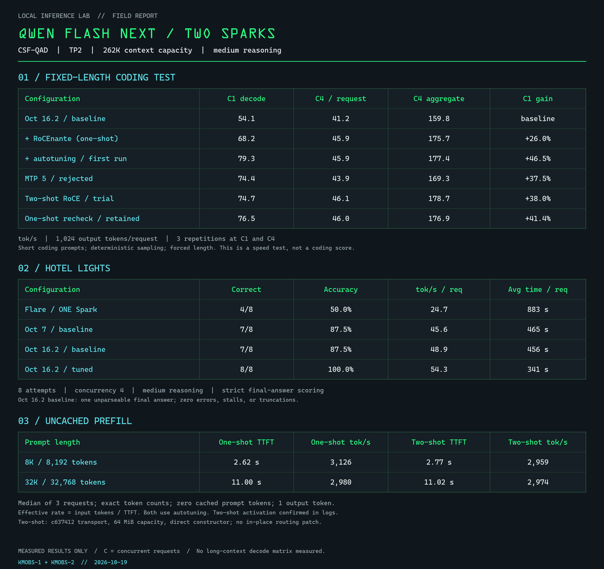

# Qwen Flash-Next on two DGX Sparks

Kit Mobley's October 19, 2026 configuration: LIL October 16.2 ARM64 build, CSF-QAD checkpoint, TP2, one-shot RoCEnante, and B12X autotuning. This is a community field report and configuration export, not an official LIL release.

## Measured results

| Test | Retained configuration |
|---|---:|
| Fixed coding, one request, recheck | 76.55 tokens/s decode |
| Fixed coding, four requests, recheck | 176.88 tokens/s aggregate end-to-end |
| 8,192 input tokens, uncached | 3,126 tokens/s effective prefill; 2.62 s TTFT |
| 32,768 input tokens, uncached | 2,980 tokens/s effective prefill; 11.00 s TTFT |
| Hotel Lights, medium reasoning, concurrency 4 | 8/8 correct; 54.3 tokens/s per request |



Raw results are in `results/`. Decode uses 1,024 forced output tokens, temperature zero, medium reasoning, three repetitions each at concurrency 1 and 4. This measures speed, not coding correctness. Single-request recheck samples ranged roughly 70.9–83.1 tokens/s. Prefill is input tokens divided by time to first token, including request overhead, with three samples per length and zero cached tokens. It is not an isolated kernel throughput measurement. Hotel Lights is a small reasoning check, not a general quality benchmark. The chart's Flare reference uses ONE Spark and is not an equal-hardware comparison. No long-context decode matrix was measured.

## Exact configuration

- Two NVIDIA DGX Sparks (GB10), one GPU each; RDMA-capable interconnect.
- Local image: `local/lil-qwen38:arm64-20261016.2` (not a public registry image).
- Model: [`local-inference-lab/Qwen3.8-Flash-Next-NVFP4-MXFP8-CSF-QAD`](https://huggingface.co/local-inference-lab/Qwen3.8-Flash-Next-NVFP4-MXFP8-CSF-QAD), revision `dc5b8ab2fa14bc4fecd6886273b7ebc6095662e2`.
- TP2; 262,144 maximum context; 16 sequences; 6,019 batched tokens; GPU memory utilization 0.55.
- `b12x` loader and linear/MoE/GDN backends; `modelopt_mixed` quantization; main KV FP8.
- MTP: four draft tokens at batch 1, three at batches 2–16; draft KV BF16.
- `VLLM_ENABLE_ROCE_ALLREDUCE=1`, `B12X_AUTOTUNE=1`; default medium reasoning.
- Canonical API ID: `qwen3.8-flash-next`. Legacy aliases are retained in the rank-0 script.

The rank scripts preserve the resolved runtime environment, including container CUDA version metadata. That metadata does not install or describe your host driver. Network addresses are parameterized. The packaged compose file changes mount paths and names for portability; it has been config-validated, but this export has not been cold-started as a new cluster. The measurements came from the original production deployment.

## Build or bring the matching image

The recipe source is [LIL blackwell-llm-docker](https://github.com/local-inference-lab/blackwell-llm-docker/tree/3d1ccd84c34ff2de6ad79004464d11474df80cb1). Component commits and assembly identity are recorded in `results/build-receipt.json`; the upstream receipt calls this research-only.

On a Spark with Docker, NVIDIA Container Toolkit, buildx, Python 3, Git and authenticated GitHub CLI:

```bash
chmod +x build/bin/*
bash build/build.sh
docker save local/lil-qwen38:arm64-20261016.2 -o qwen-1016-arm64.tar
# Copy the tar to the other Spark, then there:
docker load -i qwen-1016-arm64.tar
```

Pause serving and media jobs before compiling. Build workers are limited to avoid exhausting unified memory. The included Git wrapper removes shallow cloning for InstantTensor's libaio submodule; the Docker wrapper limits compilation parallelism without changing pinned source trees. Our successful build also compiled vLLM separately on the second Spark and supplied its wheel bundle to the assembly cache. The portable script above uses the upstream sequential component path; we have not repeated a full clean build of that simplified path. This repository does not redistribute wheels, images, or model weights. Follow their upstream licenses and access requirements.

Download the pinned model into the Hugging Face cache on BOTH nodes before serving (requires the `hf` CLI):

```bash
hf download local-inference-lab/Qwen3.8-Flash-Next-NVFP4-MXFP8-CSF-QAD --revision dc5b8ab2fa14bc4fecd6886273b7ebc6095662e2
```

## Configure and start

Clone this repository to both nodes. Copy `.env.rank0.example` to `.env` on the head and `.env.rank1.example` to `.env` on the worker. Edit the cache path, interconnect IPs, interface and HCA names. `MASTER_ADDR` is identical on both nodes; `VLLM_HOST_IP` is different. Check interface names with `ip -br addr` and RDMA devices with `ibv_devices`.

```bash
docker compose config --quiet
docker compose up -d  # run on both nodes
docker compose logs -f --tail 50
# Head, after model loading and compilation complete:
curl --fail http://localhost:8000/v1/models
```

Host networking exposes the API on port 8000 without authentication; use a trusted network/firewall or authenticated gateway. Start both ranks together. Initial compilation can take several minutes. `docker compose down` on both nodes stops this deployment. No watchdog or automatic restart is installed.

## Reproduce the speed probes

Run on the head, with no unrelated requests in flight:

```bash
python3 benchmarks/bench-tuning.py my-run
python3 benchmarks/bench-prefill.py my-run
```

These use the Python standard library and write JSON in the current directory. `BASE_URL` (default `http://localhost:8000`) and `MODEL` can be overridden. The model server must expose `/tokenize`. The included historical JSON retains the original trial labels.

## Why one-shot, and what about ComfyUI?

The activated two-shot trial measured 74.7 tokens/s single-request and 178.7 aggregate at C4, with prefill 2,959 / 2,974 tokens/s at 8K / 32K. That was no clear overall win over one-shot. Earlier tests that failed to activate two-shot were excluded. The two-shot patch is not part of this serving recipe.

At idle our deployment left about 29 GiB available on the media Spark. Qwen-Image 2.1 INT8 with Turbo8 had previously coexisted at 1024×1024, one image at a time, at about 18.7 GB of model memory. We have not repeated that render benchmark on this promoted build. Installed large video workflows pause Qwen; do not treat the unused fraction of GPU utilization as guaranteed free memory.

Credit: Local Inference Lab for the build/runtime and checkpoint; the upstream B12X/RoCEnante contributors for the kernels and transport. This repository records our configuration and measurements, not authorship of those components.
